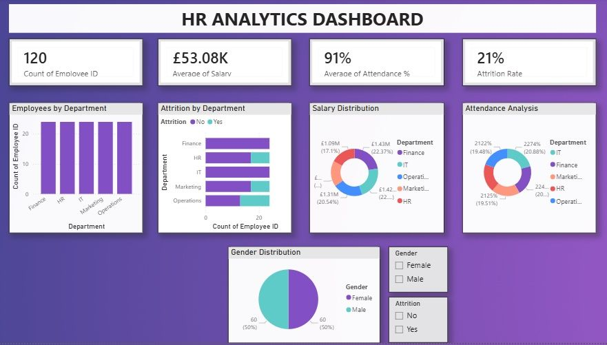

# HR Analytics Dashboard — Power BI

## Project Overview

An interactive Power BI dashboard developed to analyse workforce data and provide a clear overview of employee demographics, salary, attendance and attrition.

The dashboard brings key HR metrics together into an interactive visual reporting interface to support workforce performance analysis and management insight.

## Key Performance Indicators

- Employee Headcount: 120
- Average Salary: £53.08K
- Average Attendance: 91%
- Attrition Rate: 21%

## Analysis Included

- Employees by Department
- Attrition by Department
- Salary Distribution
- Attendance Analysis
- Gender Distribution
- Interactive filtering by Gender and Attrition

## Skills Demonstrated

- Microsoft Power BI
- Data Visualisation
- KPI Reporting
- HR Analytics
- Dashboard Development
- Trend and Performance Analysis
- Interactive Reporting
- Data-driven Insights

## Dashboard Preview

## Project Purpose

The dashboard demonstrates how workforce data can be transformed into concise visual insights for monitoring employee metrics, identifying patterns and supporting data-informed decision making.# powerbi-hr-analytics-dashboard
Power BI dashboards for HR analytics, workforce performance and employee insights.
